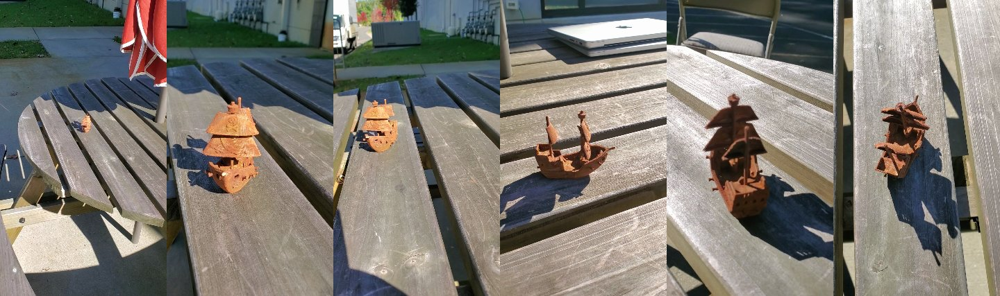
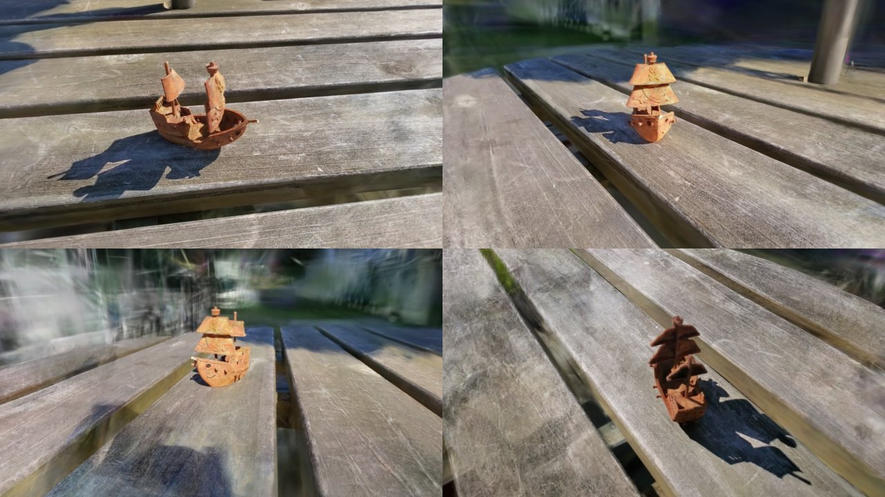

# Gaussian Splatting on a Mac: phone video → 3D scene you can fly around

Film a 30-second phone video walking around an object. This turns it into a **3D Gaussian splat**:
a 3D scene made of ~1 million tiny colored blobs. You can orbit it in a browser and render
**new videos from camera angles you never filmed**.


*Input: frames picked automatically from a 30 s phone video of a 3D-printed pirate ship.*


*Output: brand-new camera angles rendered from the trained splat. Full video: [example/pirate_ship_flyaround.mp4](example/pirate_ship_flyaround.mp4)*

---

## 👀 Just want to look at the 3D pirate ship?

**Option A: online, nothing to install**
Open **https://dovifeldman.github.io/GAUSSIAN_SPLATTING/tools/viewer/**
(it downloads the 40 MB scene, so give it a few seconds). Drag to orbit, right-drag or two fingers to pan, scroll or pinch to zoom.

**Option B: on your own computer** (any Mac, Windows or Linux machine with a modern browser)
1. Download this repo: the green **Code** button → **Download ZIP**, then unzip it.
2. Open a terminal in the unzipped folder and run:
   ```bash
   python3 -m http.server 8000
   ```
3. Open **http://localhost:8000/tools/viewer/** in Chrome, Safari, Edge or Firefox.

   (Double-clicking `index.html` won't work. Browsers block loading the 3D file from `file://`, so it needs that tiny server.)

**Option C: any online splat viewer.** Drag [`example/pirate_ship.splat`](example/pirate_ship.splat) into
[SuperSplat](https://superspl.at/editor), a free web editor from PlayCanvas. The file stays on your computer.

The full-quality version (`splat_30000.ply`, 318 MB, includes view-dependent shine) is on the
[Releases page](https://github.com/DoviFeldman/GAUSSIAN_SPLATTING/releases). You can drag it onto the viewer page too.

---

## Can my computer make one?

| Computer | Works? | Notes |
|---|---|---|
| **Apple Silicon Mac (M1–M5), 16 GB+ RAM** | ✅ Yes, this is what the scripts are built for | Tested on an M5 / 16 GB MacBook |
| Apple Silicon Mac, 8 GB RAM | ⚠️ Probably | Close other apps, and use fewer splats (see [Tuning](#tuning)) |
| Intel Mac | ❌ Not with these scripts | Brush has no prebuilt Intel-Mac build |
| Windows / Linux PC with a gaming GPU (NVIDIA / AMD, 6 GB+ VRAM) | ✅ The same tools work | Brush and pycolmap both have Windows/Linux builds, but these `.sh` scripts are Mac-only. Run the Python steps by hand (below), or use WSL on Windows |
| Laptop with only integrated graphics, or a Chromebook | ❌ Too slow / unsupported | Can still **view** splats in the browser |

**RAM:** the whole pipeline peaked at about **RAM_PEAK** while training this example
(127 frames at 900×1600, 1.35 million splats). On a Mac, RAM and graphics memory are shared, so
**16 GB is comfortable and 8 GB is tight**.

**Disk:** ~200 MB for the tools, plus ~2 GB per project (frames, COLMAP data, training checkpoints).
You can delete everything except the final `.ply` afterwards.

---

## What kind of video do I need?

- 📱 **Any phone video.** 1080p is plenty and 4K isn't needed (frames get shrunk to 1600 px anyway).
- 🔄 **Walk all the way around the object**, keeping it in frame. Get high and low angles if you can.
- 🐢 **Smooth and slow.** Blur ruins it. Pausing for a second now and then is fine, because the script automatically keeps the sharpest frame from each moment and throws out blurry ones.
- ⏱️ **20–40 seconds is ideal.** 30 seconds gave great results here.
- ☀️ **Even light, no moving things.** Sun with hard shadows was fine (the shadow gets baked into the scene). People or pets walking through the shot create ghosts.
- 🪵 **Textured surroundings help a lot.** A wood table, grass or a patterned rug gives the camera solver things to lock onto. Plain white tables and shiny or see-through objects are hard.

### How long does it take? (measured on M5 MacBook, 16 GB)

| Step | What it does | Time for the 30 s example |
|---|---|---|
| 0. Setup (once) | Download the tools | ~1–2 min on good Wi-Fi |
| 1. Pick frames | Pulls ~150 of the sharpest frames out of the video | 30 s |
| 2. COLMAP | Works out where the phone was for every frame and makes a rough 3D point cloud | 13 min |
| 3. Train (Brush) | Grows and tunes ~1.3M splats until renders match the photos (30,000 steps) | **62 min** |
| 4. Camera path | Plans a new orbit around the object | 1 s |
| 5. Record video | Renders 300 frames (10 s at 720p) and saves an mp4 | 40 s |
| **Total** | | **~75 min**, mostly hands-off |

**Longer videos:** the frame picker takes a fixed number of frames (150 by default) however long the video is, so a
1-minute video takes the **same time** as a 30 s one, just with frames spaced further apart. If you raise
`--frames` to cover a bigger scene, COLMAP gets slower fast (300 frames ≈ 3–4× longer for step 2), while training
grows more slowly (≈ 1.3–1.5×).

**Faster test runs:** train fewer steps. 7,000 steps takes about 10 min and already looks decent
(the 5,000-step checkpoint, after 6 min, already looked good). 30,000 is the full-quality default.

**Other computers (rough guesses, not measured):** an M1/M2 base chip is probably 2–3× slower at training.
An M3/M4 Pro/Max is about the same speed or faster. A recent NVIDIA gaming GPU is about the same or faster. More
RAM doesn't make it faster; it just lets you train bigger scenes without running out.

---

## Making your own (Apple Silicon Mac)

```bash
# 1. get the code
git clone https://github.com/DoviFeldman/GAUSSIAN_SPLATTING.git ~/GaussianSplatting
cd ~/GaussianSplatting

# 2. one-time setup (installs into this folder only; needs Python 3.10+, see below)
./setup.sh

# 3. video -> splat  (~75 min; run it and walk away)
scripts/run_all.sh ~/Downloads/my_video.mp4 my_thing

# 4. render a fly-around video -> projects/my_thing/new_angle.mp4
scripts/record_video.sh my_thing

# 5. look around in the browser
venv/bin/python tools/viewer/serve.py --port 8765
#    then open http://127.0.0.1:8765/tools/viewer/index.html?scene=/projects/my_thing/splat/splat_30000.ply&path=/projects/my_thing/camera_path.json
```

**Python 3.10+ needed.** macOS's built-in Python is 3.9. If `setup.sh` complains, install
[Homebrew](https://brew.sh) and run `brew install python@3.12`.

**Sharing your result:** turn the big `.ply` into a small `.splat` (about 7× smaller) and drag it onto the viewer:
```bash
venv/bin/python scripts/ply_to_splat.py projects/my_thing/splat/splat_30000.ply my_thing.splat
```

### Other camera moves

```bash
venv/bin/python scripts/make_camera_path.py projects/my_thing --seconds 12 --elev-high 70 --elev-low 20 --zoom 0.6
scripts/record_video.sh my_thing
```
- `--elev-high` / `--elev-low`: degrees above the table at the start and halfway round (the camera swoops between them)
- `--zoom`: below 1 means closer than you filmed
- `--width 1080 --height 1920`: vertical video for phones
- Below ~15° you start seeing smeared background, because nobody filmed those spots.

---

## How it works (what each program does)

```
phone video ──► extract_frames.py ──► COLMAP ──► Brush ──► .ply splat ──► viewer / record_video.sh ──► mp4
                 (sharp frames)      (camera    (training)                (WebGL in the browser)
                                      positions)
```

| Program | What it is | Link / license |
|---|---|---|
| **OpenCV** | Reads the video, measures sharpness (Laplacian variance), and writes the final mp4 | [opencv.org](https://opencv.org) · Apache 2.0 |
| **COLMAP** via **pycolmap** | "Structure from Motion": matches features between photos to work out each camera's position, lens and a sparse 3D point cloud. pycolmap is the official Python package, a 20 MB download with nothing to compile | [colmap.github.io](https://colmap.github.io) · BSD |
| **Brush** | Trains the Gaussian splat on the GPU. Uses WebGPU, so it runs on Apple Metal with no NVIDIA/CUDA needed | [github.com/ArthurBrussee/brush](https://github.com/ArthurBrussee/brush) · Apache 2.0 |
| **three.js** + **GaussianSplats3D** | Draws splats in the browser (included in `tools/viewer/lib/`) | [three.js](https://threejs.org) · [mkkellogg/GaussianSplats3D](https://github.com/mkkellogg/GaussianSplats3D) · MIT |
| **Google Chrome (headless)** | `record_video.sh` runs a hidden Chrome window with a throwaway profile to render video frames. It doesn't touch your normal Chrome | already on most Macs |

**Files in this repo**

| Path | What it does |
|---|---|
| `setup.sh` | One-time install: Python venv + Brush (checksum-verified) |
| `scripts/run_all.sh` | Runs steps 1–4 in a row |
| `scripts/extract_frames.py` | Splits the video into 150 equal time slices and keeps the sharpest frame of each. Drops slices that are all blur |
| `scripts/run_colmap.py` | COLMAP: features → match every pair of frames → 3D reconstruction → undistort, giving `dataset/` ready for Brush |
| `scripts/make_camera_path.py` | Finds the object (where all camera views point), the table plane (so "up" is level) and the filming distance, then writes a new orbit to `camera_path.json` |
| `scripts/record_video.sh` | Renders `camera_path.json` to an mp4 using the viewer in headless Chrome |
| `scripts/ply_to_splat.py` | Shrinks a trained `.ply` into a shareable `.splat` |
| `scripts/blender_import_splat.py` | Optional Blender preview (see below) |
| `tools/viewer/` | The browser viewer (`index.html`) and a tiny local server (`serve.py`) that also saves recorded frames |
| `example/` | The pirate ship: `.splat` file, camera path, rendered video, preview images |

### What happens during training?
Brush starts with one blob per COLMAP point (~100k). It renders the blobs from each photo's camera position,
compares the render to the real photo, and nudges every blob's position, size, rotation, color and transparency
to reduce the difference. It also splits blobs where detail is missing and deletes useless ones. After 30,000
rounds you get ~1.3M blobs that look right from every angle, including angles between the photos.

---

## Do I need Blender?

**No.** Nothing in the pipeline needs Blender. The browser viewer and `record_video.sh` handle viewing and making videos.

**Why you might want it anyway:** Blender is handy for placing the splat in a bigger 3D scene, lining up
cameras by eye, or mixing it with regular 3D models. `scripts/blender_import_splat.py` imports a splat as
colored points (paste into Blender's Scripting tab):
```python
PLY = "/Users/you/GaussianSplatting/projects/my_thing/splat/splat_30000.ply"
exec(open("/Users/you/GaussianSplatting/scripts/blender_import_splat.py").read())
```
It's only a **rough preview** (round dots, not soft stretched splats), because Blender 5.1 can't draw true splats by itself.
For real splat rendering inside Blender, install the free
[KIRI Engine 3DGS Render add-on](https://github.com/Kiri-Innovation/3dgs-render-blender-addon) (a big ~770 MB download).

---

## Tuning

| Problem | Fix |
|---|---|
| Out of memory / Mac slows to a crawl | In `scripts/run_all.sh`, add `--max-splats 1500000 --max-resolution 1280` to the Brush command |
| COLMAP only placed some frames (`best has 60/127 images`) | Film slower with more overlap, or use `--frames 250` in `run_all.sh` |
| Crooked horizon in the video | Happens with no flat ground; the path script falls back to the plane you walked in. Try `--elev-high`/`--elev-low` |
| Smeary "fog" around the edges | Normal for areas you didn't film. Keep the camera path closer to how you filmed (`--zoom 0.8–1.0`, `--elev-low 20`) |
| Viewer page is black and says "Loading…" | Open it through a server (`http://…`), not by double-clicking the file |
| In the Claude desktop app's browser pane | Use `127.0.0.1` instead of `localhost` |

### Windows / Linux (manual steps)
Install Python 3.10+, `pip install -r requirements.txt`, and download Brush for your OS from its
[releases page](https://github.com/ArthurBrussee/brush/releases). Then run the same steps by hand:
```
python scripts/extract_frames.py my_video.mp4 projects/my_thing/images
python scripts/run_colmap.py projects/my_thing
cd projects/my_thing && brush_app dataset --total-steps 30000 --export-path splat --export-name "splat_{iter}.ply"
python scripts/make_camera_path.py projects/my_thing
```
To view: `python tools/viewer/serve.py`, then open the viewer URL as above. (`record_video.sh` is Mac-only, but the
Chrome command inside it is easy to adapt.)

---

## Notes for an AI agent repeating this
- Run `run_all.sh` in the background. Brush prints nothing while training, so watch `projects/NAME/splat/` for
  `splat_05000.ply` … `splat_30000.ply`. Each 5k checkpoint is a viewable splat, so check the first one early.
- On slow internet, avoid `brew install colmap` (~100 dependencies, including Qt and gcc). pycolmap is a single 20 MB wheel.
- Before rendering, look at a few frames from `record_video.sh` (`projects/NAME/render_frames/`). The first frame
  used to come out black until the warm-up render was added to the viewer, so keep that block.
- Tested 2026-10-22: macOS 26.4, Apple M5, 16 GB, Brush 0.3.0, pycolmap 4.2.1, three.js 0.170.0, GaussianSplats3D 0.4.7.
