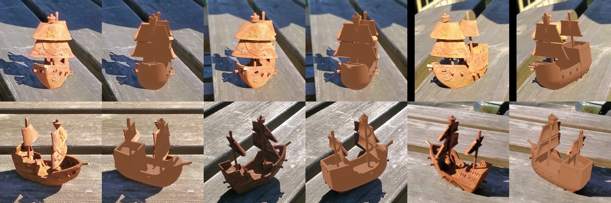
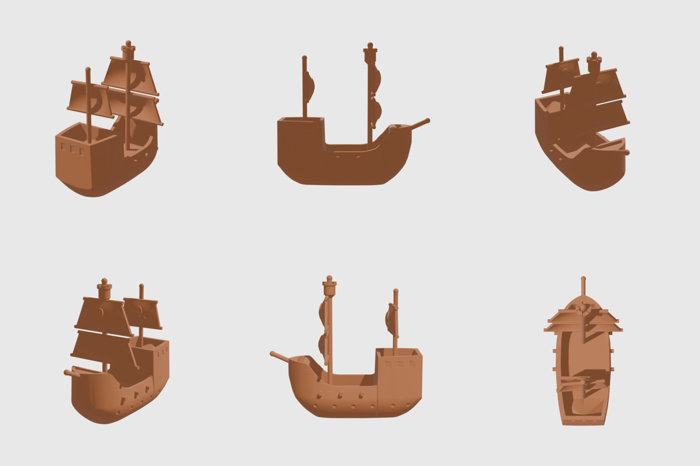

# Splat → 3D-printable model (pirate ship)

The rusty 3D-printed toy pirate ship from the splat in this repo, turned back into a clean, solid,
**3D-printable model** for Bambu Studio (or any slicer).


*Each pair: a real video frame (left) and the model rendered from that frame's exact camera pose, laid over it (right).*



## Download
- [`model/pirate_ship_clean.stl`](model/pirate_ship_clean.stl) / [`model/pirate_ship_clean.3mf`](model/pirate_ship_clean.3mf)
- **90.1 × 48.4 × 84.2 mm** (L × W × H), 51 cm³, one watertight manifold body, flat base (~850 mm²) at Z = 0
- Sails 1.6 mm, masts 2.6–2.9 mm, yards 2 mm, hull walls 2.3 mm
- Print it upright with supports on (tree supports work well): the sail bottoms and yards overhang.
  0.12–0.16 mm layers keep the skull reliefs readable.

## How it was made
1. Crop the ship out of the splat and level it to the table (`camera_path.json` gives the centre and the table normal).
2. Cut the rust-orange ship out of all 127 COLMAP photos by colour, and carve a **visual hull** with tolerant voting.
3. **Measure** that hull at print scale: hull stations, sheer line, keel, mast positions, sail heights and widths.
4. **Hand-model** the ship from clean solids with manifold3d: a lofted bowl hull with recessed decks, a stern castle,
   cannons, portholes, windows, bowsprit, masts, three billowing sails on yards with raised skull / crossed-swords
   emblems, and a crown-style crow's nest.
5. Render it from the real camera poses, compare it to the photos, fix it, check printability, and export.

The scan is only used for measuring. Meshing it directly also gave a printable model, but a lumpy one
([see why](images/rejected_visual_hull_compare.jpg)), so the hand-modelled version is the one to use.

- **[PROMPT.md](PROMPT.md)**: a prompt you can paste into a new Claude Code session to repeat this (on this ship or a new object).
- **[LESSONS.md](LESSONS.md)**: what worked, what didn't, and gotchas.

## Re-run
```bash
cd ~/GaussianSplatting/projects/pirate_ship && mkdir -p print && cd print
python3.12 -m venv venv && ./venv/bin/pip install -r ~/GaussianSplatting/splat_to_print/scripts/requirements.txt
export SPLAT_PROJECT=~/GaussianSplatting/projects/pirate_ship; S=~/GaussianSplatting/splat_to_print/scripts
./venv/bin/python $S/01_crop_splat.py                      # splat -> levelled crop (work/crop.npz)
~/GaussianSplatting/venv/bin/python $S/02_export_cams.py   # COLMAP cameras (needs pycolmap)
./venv/bin/python $S/03_visual_hull.py 0.003 0.06          # silhouettes -> voxel hull (~90 s)
./venv/bin/python $S/04_measure_scan.py 90                 # measurement tables at 90 mm length
./venv/bin/python $S/05_model_clean.py                     # THE MODEL -> pirate_ship_clean.stl/.3mf
./venv/bin/python $S/06_compare_cams.py                    # real camera poses in model coordinates
/Applications/Blender.app/Contents/MacOS/Blender --background --factory-startup --python $S/07_render_blender.py -- pirate_ship_clean.stl
./venv/bin/python $S/08_contact_sheets.py                  # renders/*_previews.jpg, *_compare.jpg
./venv/bin/python $S/09_check_print.py pirate_ship_clean.stl
```
Tested 2026-10-23 on macOS 26.4 / M5: re-running gives a byte-identical STL. Python 3.12, manifold3d 3.5.4,
trimesh 5.1.1, open3d 0.20.0, pycolmap 4.2.1, Blender (EEVEE) headless.
